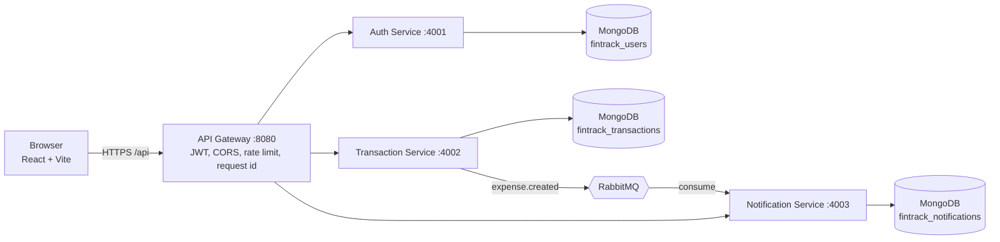

# FinTrack

Personal finance tracker built as **MERN microservices**: record income and expenses, see a monthly dashboard, and get an in-app alert when a single expense crosses your limit.

> Status and live links: fill in the [Live URLs](#live-urls) section after deployment.

## Features

- Register, log in, log out; short-lived access token plus **rotating refresh token** in an HttpOnly cookie
- Add, edit, delete transactions (INR, income or expense, category, date, optional note)
- Filter by month, type, category; search notes; sort; pagination
- Dashboard for any month: total income, total expenses, balance, income-vs-expense chart, category pie chart, 6-month trend, recent transactions
- Expense alert threshold (default ₹10,000): a notification appears in the bell when **one** expense is above it. Alerts are created asynchronously through RabbitMQ and never slow down saving a transaction
- Swagger UI at `/docs` on the gateway

## Architecture



The frontend talks **only** to the gateway. No service reads another service's database; they communicate over HTTP (via the gateway) or events.

### Services and ports

| Component | Port | Responsibility | Data store |
|---|---|---|---|
| frontend (nginx) | 3000 (local) | React UI, proxies `/api` to the gateway | none |
| gateway | 8080 | single public entry point, JWT verification, CORS, rate limiting, request id, Swagger UI | none |
| auth-service | 4001 | register, login, refresh rotation, logout, profile | `fintrack_users` |
| transaction-service | 4002 | CRUD, filters, pagination, monthly summary, publishes events | `fintrack_transactions` |
| notification-service | 4003 | consumes events, stores alerts, holds the threshold | `fintrack_notifications` |
| rabbitmq | 5672 / 15672 | message broker / management UI | volume |

### Event flow (RabbitMQ)

1. `POST /transactions` saves an **expense**, answers `201`, and publishes `expense.created` without waiting for the consumer.
2. Event payload: `eventId`, `transactionId`, `userId`, `amount`, `category`, `date`, `occurredAt`. The `eventId` is deterministic (`expense.created:<transactionId>`).
3. Exchange `fintrack.events` (topic, durable) routes to the durable queue `notifications.expense`. Messages are persistent.
4. The notification service consumes with **manual acknowledgement**, compares `amount` with the user's threshold (strictly greater than), and stores a notification.
5. **Idempotency:** a unique index on `eventId` means a redelivered event can never create a second notification.
6. **Failure handling:** on an error the message goes to `notifications.retry` (10 s delay, dead-letters back to the main queue), up to 3 attempts, then to `notifications.dlq`. Malformed payloads go straight to the DLQ.

**Why RabbitMQ:** durable queues, acknowledgements and dead-lettering are built in, which is exactly what an "alert must not be lost" workflow needs. Redis Pub/Sub is fire-and-forget (messages are lost if the consumer is down), and Kafka is more than this workload needs.

### Authentication flow

1. `POST /api/auth/login` returns an access token (JWT, 15 min) in the body and sets `refreshToken` as an **HttpOnly, Secure, SameSite** cookie scoped to `/api/auth`.
2. The frontend keeps the access token **in memory only**, never in localStorage.
3. On a `401` the Axios interceptor calls `/api/auth/refresh` once (parallel requests share it), then retries.
4. Refresh tokens are random opaque strings, stored only as a SHA-256 hash, and are **single use**. Reusing an old one revokes the whole token family.
5. On page reload the app calls `/refresh` first, which restores the session.
6. The gateway verifies the JWT and forwards `x-user-id` and a shared `x-internal-token` to services. Services reject requests without the internal token, so they cannot be called around the gateway.

## Tech stack

React 18, Vite, Tailwind CSS, React Router, Axios, Recharts, React Hook Form + Zod, Lucide, react-hot-toast · Node 20, Express, MongoDB + Mongoose, JWT, bcryptjs, Zod, Pino · RabbitMQ (amqplib) · Jest + Supertest · Docker + Docker Compose.

## Run locally

Requirements: Docker Desktop. No cloud account needed.

```bash
cp .env.example .env          # optional, compose has working local defaults
docker compose up --build
```

| URL | What |
|---|---|
| http://localhost:3000 | App |
| http://localhost:8080/health | Gateway health |
| http://localhost:8080/health/services | Health of every service |
| http://localhost:8080/docs | Swagger UI |
| http://localhost:15672 | RabbitMQ UI (`fintrack` / `fintrack_local_pw`) |

Seed the demo account (works against any environment through the public API):

```bash
docker compose --profile seed run --rm seed
# or, against any URL:
DEMO_EMAIL=demo@fintrack.local DEMO_PASSWORD='Demo1234pass' API_URL=http://localhost:8080 node scripts/seed.js
```

The seed creates 23 transactions across the last three months, with several income and expense categories, and sets the alert limit to ₹10,000. The ₹18,000 rent and ₹12,500 shopping expenses exceed it, so the bell shows alerts right away.

### Without Docker

```bash
npm run install:all
# start MongoDB and RabbitMQ yourself, set the variables from .env.example for each service, then in 5 terminals:
npm run dev --prefix services/auth-service
npm run dev --prefix services/transaction-service
npm run dev --prefix services/notification-service
npm run dev --prefix gateway
npm run dev --prefix frontend      # http://localhost:5173, /api is proxied to :8080
```

## Tests and lint

```bash
npm run install:all
npm test        # gateway + auth + transaction + notification (Jest + Supertest)
npm run lint    # ESLint in every package
```

Service tests use `mongodb-memory-server` (downloads a MongoDB binary on first run, so the first run needs internet) and a mocked broker, so no external services are required.

Covered: registration, duplicate email, bcrypt hashing, login, wrong password, refresh rotation and reuse detection, logout, unauthorized access · transaction create/update/delete, validation, user ownership, filters, pagination, monthly summary maths, event publishing · threshold comparison, event consumption, retries and dead-lettering, duplicate events, mark as read.

## Environment variables

See [`.env.example`](.env.example): it lists every variable per service, which hosted service to use, and where to find each value.

## API documentation

OpenAPI spec: [`gateway/openapi.yaml`](gateway/openapi.yaml), served as Swagger UI at `/docs` on the gateway. Every error uses one format:

```json
{ "success": false, "message": "Human readable", "error": { "code": "VALIDATION_ERROR" }, "requestId": "..." }
```

## Logging

Pino structured JSON logs with `service`, `requestId`, method, path, status and `responseTime` (ms). The gateway creates (or validates) `x-request-id` and forwards it to every service. Passwords, tokens and cookies are redacted.

## CI/CD and deployment

The pipeline is `.github/workflows/ci-cd.yml` (runs on push and pull requests to `main`). Flow: lint → test → build images → push to GHCR (tag = commit SHA and `latest`) → deploy hooks → post-deploy `/health` check. Required secrets and the Render/Vercel setup are listed in section 3 of [`.env.example`](.env.example).

Each service has a Dockerfile (multi-stage, non-root user, health check). Commit the `package-lock.json` files: the Dockerfiles use `npm ci` when a lockfile exists.

## Live URLs

| | |
|---|---|
| Frontend | _add after deploy_ |
| API gateway | _add after deploy_ |
| Swagger UI | _gateway URL_/docs |
| GitHub Actions run | _add after first green run_ |
| Demo login | _email / password, created by the seed script_ |

**Cold starts:** on free hosting the services sleep after ~15 minutes idle; the first request can take 30-60 s while they wake up (the app allows 60 s). An uptime monitor pinging `/health` keeps them warm.

## Technical trade-offs

- **Dual write:** the transaction is saved, then the event is published. If the broker is down at that moment the event is lost (the transaction is still saved). The production fix is the transactional outbox pattern.
- **Money as integer paise** in the database to avoid floating-point errors; the API uses rupees.
- **Date-only values** stored at 00:00 UTC, so month filters never shift with timezones.
- **bcryptjs** (pure JavaScript) instead of native `bcrypt`: slightly slower, but no native build step in Alpine images.
- **Internal token** instead of network isolation: free Render services are public, so a shared secret is what stops requests that bypass the gateway.
- **Polling** (every 20 s) for the notification bell instead of WebSockets/SSE, to keep the core simple.
- **Refresh in several tabs:** because refresh tokens are single use with reuse detection, two tabs refreshing at the exact same moment can end the session; the user just logs in again.
- Category lists are duplicated in the frontend and the transaction service.

## Known limitations

- Only the three-service core is built; bonus items (Redis cache, SSE, Playwright, Kubernetes, admin role) are not implemented.
- No email verification or password reset.
- Free-tier cold starts (see above).
- Tests were written together with the code; run `npm test` to confirm they pass in your environment before relying on them.

## Future improvements

Transactional outbox, Redis cache for monthly summaries with invalidation on writes, SSE for real-time alerts, Playwright end-to-end tests in the pipeline, TypeScript, circuit breaker and retries between services, staging environment, admin role.

## AI usage

_Edit this section so it is true for you before submitting._ Claude was used to help with architecture, writing the code, tests and documentation. I reviewed the code, ran the tests, and I am able to explain every part of it.
